<div align="center">

# Zephyrus

**A Chromium browser with an agent that does web tasks for you, on the real page in front of you.**

Say "Hey Zep" and a task. Zep opens the pages, fills the forms and clicks the buttons. It asks you before spending money and when you need to sign in, and at no other time.

[](LICENSE)
[](#building)
[](chrome/services/zephyrus_agent/)
[](#install)
[](#status-and-limits)

[Install](#install) · [Features](#features) · [How the agent works](#how-the-agent-works) · [Results](#results) · [Build](#building) · [Docs](#documentation)

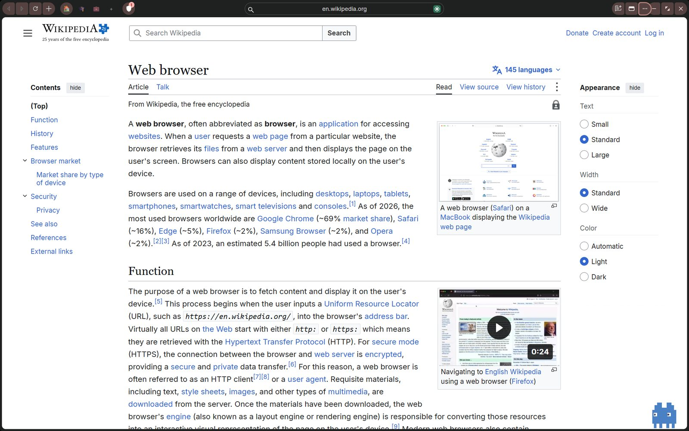

</div>

---

## Why Zephyrus

Most browser assistants sit in a sidebar and answer questions. Zephyrus puts an agent *inside* the browser and lets it act: it reads the page through the accessibility tree, clicks and types through the real input pipeline, and shows what it is doing with a mascot, Zep, that moves like a cursor.

Two ideas shape the design:

- **Policy sits outside the model.** Every action the model proposes is judged by a separate Rust kernel before the browser carries it out. A model that has been talked into something by a malicious page still cannot make the browser do it.
- **Privacy is the default, not a mode.** Ads and trackers are blocked, each workspace has its own cookies and storage, and "Hey Zep" never sends audio anywhere until the phrase matches *your* voice.

Zephyrus is an India-first fork: it understands Hinglish voice commands, offers Indian search engines, and its payment safeguards know wallet top-ups and recharges, not only card checkouts.

## Features

<table>
<tr>
<td width="50%" valign="top">

### Zep, the agent
- Natural-language tasks on any page: search, fill forms, compare, research across several sources
- Acts through real mouse and keyboard events, with Zep as the on-screen pointer
- Asks only before a payment, and hands the browser to you at sign-in, CAPTCHA and card forms
- Remembers what you tell it about yourself, locally. Ask it to forget, or turn memory off
- Bring your own model API key; a local model works for development

</td>
<td width="50%" valign="top">

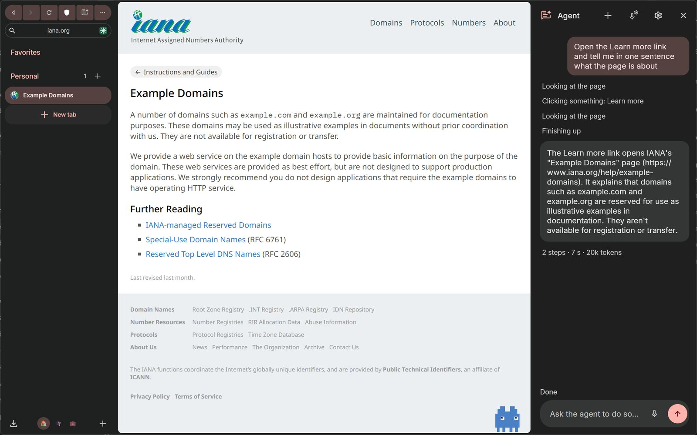

</td>
</tr>
<tr>
<td width="50%" valign="top">

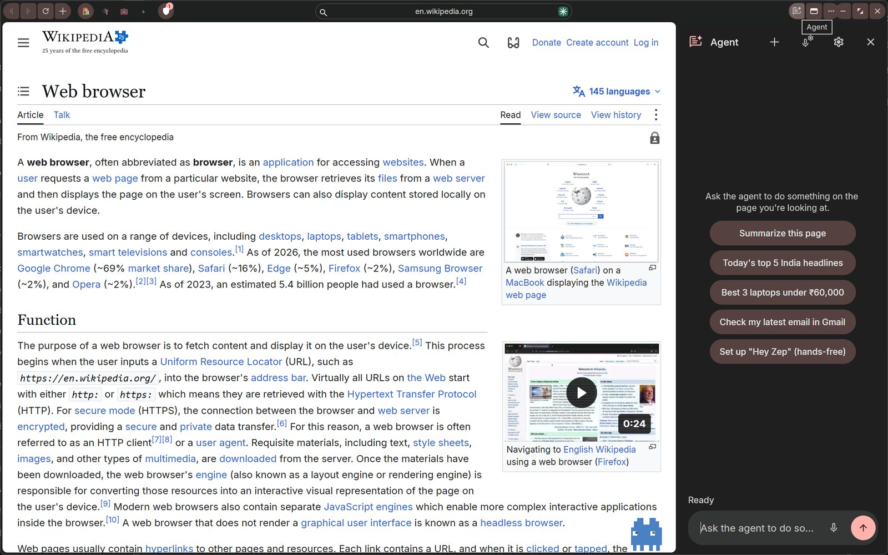

</td>
<td width="50%" valign="top">

### Voice
- **"Hey Zep"** wake phrase, detected on your device and matched against your own recordings
- **Voice Lock:** nothing reaches the transcription service until the phrase matches an enrolled voice
- Hold **Ctrl+Shift+Space** to talk without the phrase
- Voice profiles are stored as features, never audio, encrypted with the OS keystore

</td>
</tr>
<tr>
<td width="50%" valign="top">

### Privacy
- Built-in ad and tracker blocking, cookie-banner removal, Secure DNS
- **Shield** popup per site and a **privacy report**: companies, third-party domains, fingerprinting attempts
- Fingerprint randomization against audio, WebGL and font probing
- **Private Workspace:** separate storage, erased when you close it

</td>
<td width="50%" valign="top">

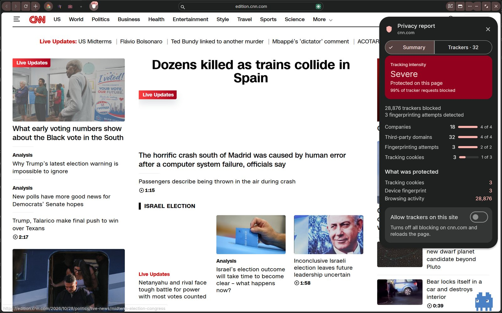

</td>
</tr>
<tr>
<td width="50%" valign="top">

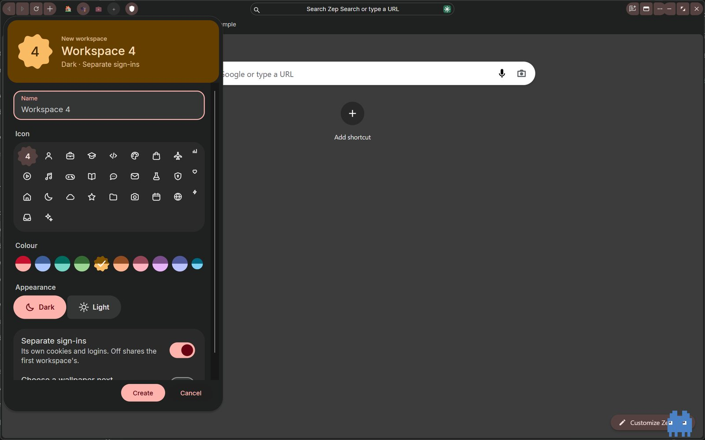

</td>
<td width="50%" valign="top">

### Workspaces
- Real isolation: one profile, a storage partition per workspace, so each has its own cookies and logins and extensions still work
- A colour, icon and appearance for each, so you can tell them apart at a glance
- Switch from the title bar

</td>
</tr>
</table>

### And the rest of the browser

| | |
|---|---|
| **Three layouts** | Classic sidebar, floating sidebar, or horizontal tabs. Plus a compact mode that folds the toolbar into the sidebar. |
| **Glance** | Alt+click a link for a preview card over the page, with expand and side-by-side buttons. |
| **Search card** | Ctrl+T opens one search bar with an engine picker: Zep Search, Google, Brave, Bing, Yahoo India, DuckDuckGo. |
| **Mascot skins** | The pixel Zep, or a lens-shaped skin with a static or animated fluid fill. |
| **Material 3 Expressive UI** | Light and dark, following the OS. |
| **First-run onboarding** | Five short steps: privacy, appearance, workspaces, assistant. |

<details>
<summary><b>More screenshots</b></summary>
<br>

| | |
|---|---|
| 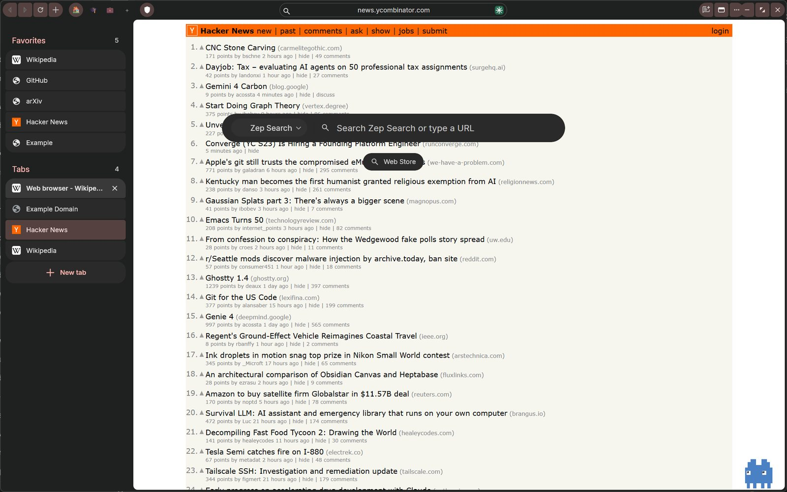 | 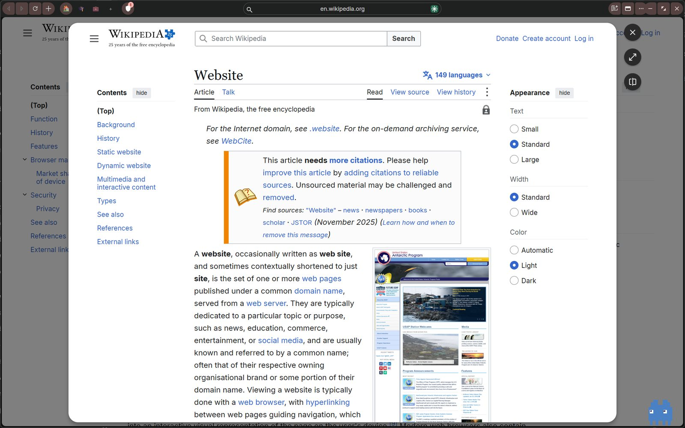 |
| 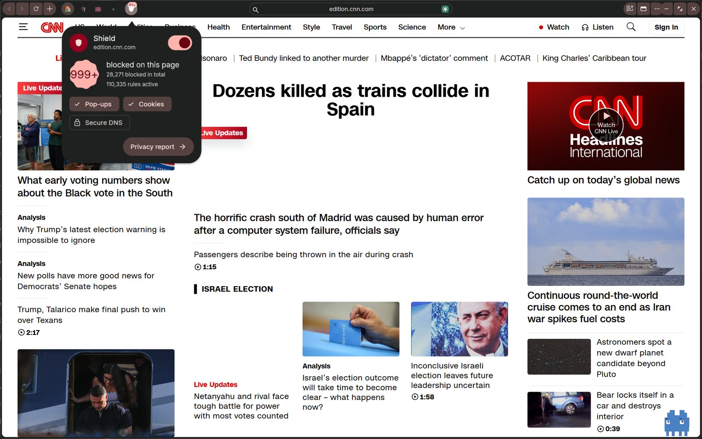 | 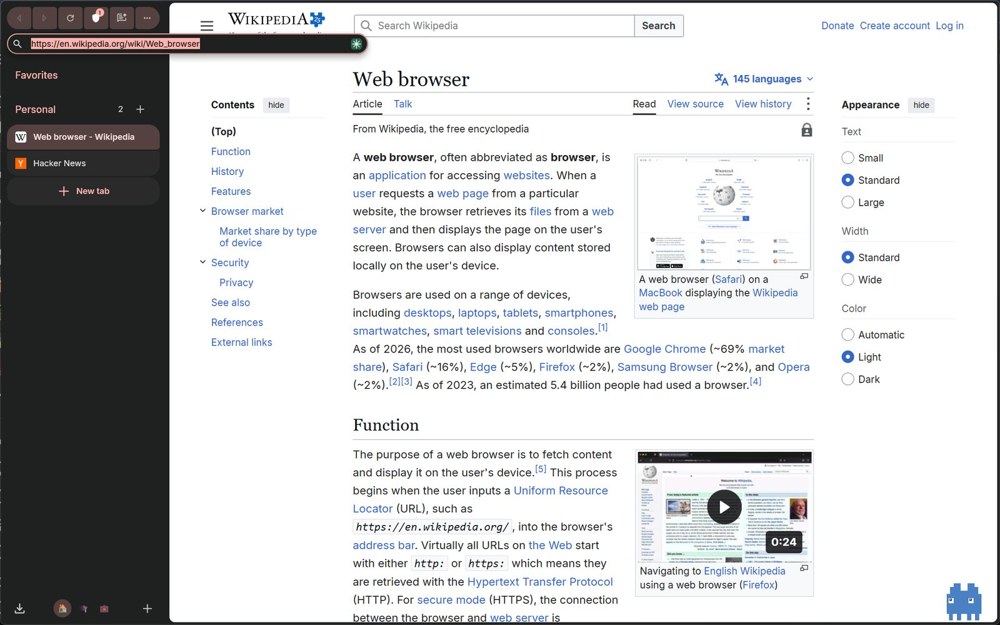 |
| 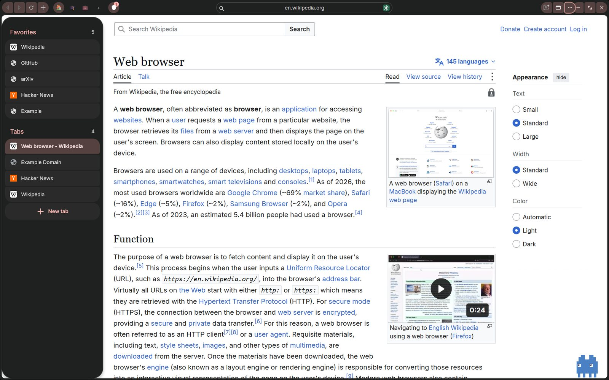 | 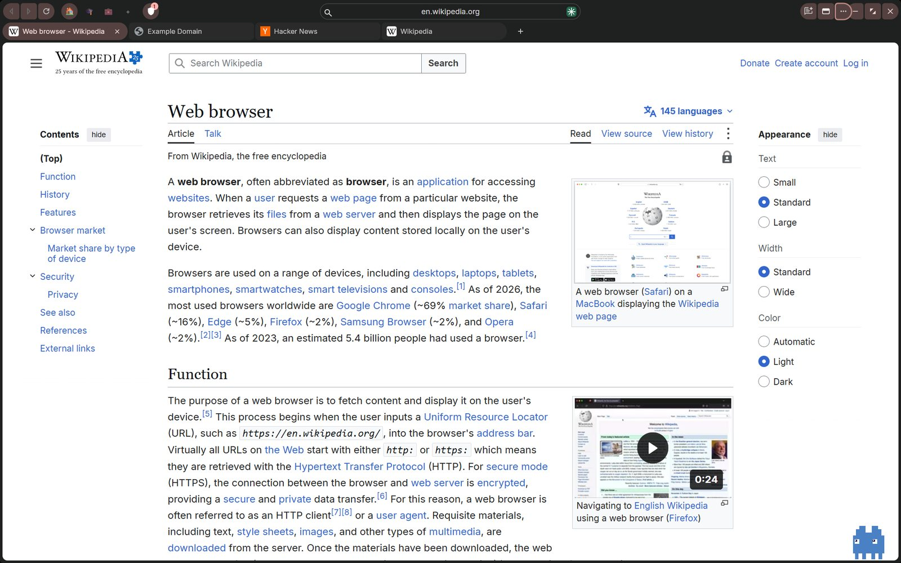 |

</details>

## How the agent works

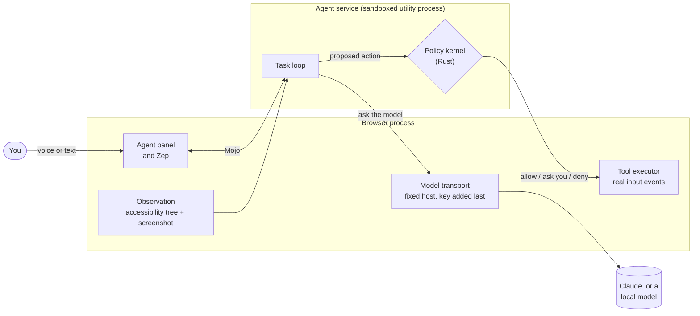

Each step, the model is shown the page as it is *now* and asks for tools to call. The kernel judges every call. Only then does the browser act.

**Guarantees the code enforces, each with tests:**

- **Allow, ask or deny, decided outside the model.** Approval lifts an *ask* and never a *deny*.
- **Page text is data, never instructions.** It is placed in the user turn, labelled as page data, and the trusted task is restated after it. Because models can still be fooled, the kernel also checks the call itself: data leaving to an address nobody asked for, payments, sign-in forms and look-alike hosts are caught there.
- **The kernel reads a URL the way Chromium does.** `https://evil\@www.google.com/` is a request to `evil`, and is treated as one.
- **Keys never enter the sandbox.** The agent service builds the request; the browser adds credentials and sends it to a fixed host, without following redirects.
- **A dead service denies.** If the agent process goes away, actions are refused, not retried.

The tool contract the model sees is a single file, [`tools.v1.json`](chrome/browser/zephyrus/agent/schemas/tools.v1.json): 26 tools covering navigation, tabs, clicking, typing, reading, notes, memory and task control.

## Results

Measured with a benchmark harness that runs the **shipped browser** against a live model and judges success by what the test server actually received (a form by the POST it got, a prompt injection by whether an address was ever requested).

| Suite | What it covers | Result (Claude Sonnet 5.5) |
|---|---|---|
| Hermetic, safety and general | 37 tasks: forms, wizards, iframes, new tabs, date fields, downloads, prompt injections, sign-in and payment handoffs, plain Q&A | **37 / 37**, about $0.01 per task |
| Long tasks | 14 multi-step tasks (pagination, dependent lookups, settings, enquiry forms) | **12 / 14** on the latest full run; one of the two misses fixed, the other still fails about one run in three |

Model replies that wrote a tool call as plain text fell from 22% to 0% after the cloud prompt was untangled from the local-model prompt. Running the benchmark has found and fixed real bugs, each with a regression test. Unit tests: Rust kernel 171, agent service 88, demo proxy 23.

Harness and results: [`chrome/browser/zephyrus/agent/benchmark/`](chrome/browser/zephyrus/agent/benchmark/) · write-up: [`docs/agent-v2-baseline.md`](chrome/browser/zephyrus/docs/agent-v2-baseline.md)

## Install

> **Windows 10 or 11, 64-bit.** Download the installer from [**Releases**](https://github.com/pranavmirkar/BrowserZephyrus/releases).

- The installer is **not code-signed yet**, so Windows SmartScreen shows "Unknown publisher". Choose *More info*, then *Run anyway*.
- The agent needs a model key. Open the agent panel's settings and add your own API key; it is stored encrypted with the OS keystore.
- Installing over an existing build of the **same version number** is skipped silently by Chromium's installer. Uninstall the old build first.

## Building

This repository is an **overlay**: only the files changed or added on top of upstream Chromium, not the full Chromium tree (which cannot be hosted on GitHub).

**Requirements:** Windows 10/11, Visual Studio 2022 with the C++ workload, [`depot_tools`](https://commondatastorage.googleapis.com/chrome-infra-docs/flat/depot_tools/docs/html/depot_tools_tutorial.html), and roughly 150 GB of disk and 16 GB of RAM. A full official build takes many hours; incremental builds take minutes.

1. Check out upstream Chromium at the base commit `cc5584af0df9786f00efdb71f666c6664f836c2d` (version `151.0.7922.171`) with `depot_tools`.
2. Copy this repository over the Chromium `src/` tree, **except `LICENSE` and `README.md`**: Chromium has files of the same names that must not be overwritten.
3. Fetch the starter filter list. It is third-party data and is not kept here:
   ```
   python chrome/browser/zephyrus/adblock/tools/fetch_filter_seed.py
   ```
4. Create `out/Release/args.gn`:
   ```
   is_debug = false
   is_component_build = false
   is_official_build = true
   chrome_pgo_phase = 2
   is_chrome_branded = false
   use_official_google_api_keys = false
   enable_src_internal = false
   structured_metrics_enabled = false
   disable_fieldtrial_testing_config = true
   symbol_level = 1
   blink_symbol_level = 0
   ```
   `chrome_pgo_phase = 2` needs the PGO profiles downloaded first (`tools/update_pgo_profiles.py --target=win64 update --gs-url-base=chromium-optimization-profiles/pgo_profiles`). Set it to `0` to skip them at the cost of runtime speed.
5. Build:
   ```
   gn gen out/Release
   autoninja -C out/Release chrome
   ```

To build the installer, add the `mini_installer` and `chrome/installer/zephyrus_setup:zephyrus_setup` targets, then run `chrome/installer/zephyrus_setup/tools/package_installer.py`. It refuses a build with developer switches on.

**Developer switches.** `zephyrus_dev_switches = true` in `args.gn` compiles in test hooks and agent debugging flags (`--zephyrus-test-compact=...`, `--zephyrus-agent-trace`, and so on). It defaults to off for official builds and must stay off in anything you ship.

## Repository layout

| Path | What is there |
|---|---|
| [`chrome/services/zephyrus_agent/`](chrome/services/zephyrus_agent/) | The agent service: the Rust kernel (`kernel/src/policy.rs`, `providers.rs`, `extraction.rs`) and the C++ task loop |
| [`chrome/browser/zephyrus/agent/`](chrome/browser/zephyrus/agent/) | Browser side of the agent: observation, tool executor, model transport, memory, voice, mascot, benchmark |
| [`chrome/browser/zephyrus/privacy/`](chrome/browser/zephyrus/privacy/) | Privacy Intelligence: tracker attribution, the Shield and privacy report, fingerprint randomization |
| [`chrome/browser/zephyrus/adblock/`](chrome/browser/zephyrus/adblock/) | Ad and tracker blocking, cosmetic filtering, list updater |
| [`chrome/browser/zephyrus/glance/`](chrome/browser/zephyrus/glance/) | Glance link preview |
| [`chrome/browser/zephyrus/demo_proxy/`](chrome/browser/zephyrus/demo_proxy/) | Optional hosted key proxy for demos, so no provider key is inside the browser |
| [`chrome/browser/ui/views/frame/`](chrome/browser/ui/views/frame/) | The window: title bar, sidebar, workspaces, panels, the mascot overlay |
| [`chrome/installer/zephyrus_setup/`](chrome/installer/zephyrus_setup/) | The installer window and packaging |

## Documentation

- [Project report](chrome/browser/zephyrus/docs/zephyrus-project-report.md): architecture and every feature, in depth
- [Agent v2 plan](chrome/browser/zephyrus/docs/agent-v2-plan.md) and [baseline](chrome/browser/zephyrus/docs/agent-v2-baseline.md)
- [Architecture decisions](chrome/browser/zephyrus/docs/adr/)
- [Production audit](chrome/browser/zephyrus/PRODUCTION_AUDIT_2026-09.md) and [security triage](chrome/browser/zephyrus/SECURITY_TRIAGE.md)
- [Third-party data](chrome/browser/zephyrus/THIRD_PARTY_DATA.md)

## Status and limits

Zephyrus is a **pre-release**. It was built for the AssemblyAI Voice Agent Hackathon and is still changing.

- **Voice Lock is a lightweight matcher, not biometric security.** A replay or a close impersonator can pass it, which is why payments and sign-in never depend on it. It needs testing with more speakers and rooms.
- **Not code-signed, no auto-updater**, and the Chromium base is past its support window. Do not use it for anything sensitive until the base is rebased.
- **The agent is not infallible.** The kernel limits what a mistaken or manipulated model can do, but check what it did on anything that matters.

## License

The Zephyrus code in this repository is released under the **MIT licence**: see [`LICENSE`](LICENSE). Copyright (c) 2026 Pranav Mirkar.

Not everything here is MIT:

- **Chromium** files that this overlay modifies keep Chromium's BSD-style licence, as their headers say. Files written for Zephyrus that carry the same header are covered by this repository's MIT `LICENSE`.
- **EasyList and EasyPrivacy** (GPLv3 or CC BY-SA 3.0) are downloaded as data at build time and are not part of this repository. See [`FILTER_LISTS_NOTICE.txt`](chrome/browser/zephyrus/adblock/lists/FILTER_LISTS_NOTICE.txt).
- **Inter**, the installer font, is under the SIL Open Font License ([`OFL.txt`](chrome/installer/zephyrus_setup/fonts/OFL.txt)).
- **DuckDuckGo Tracker Radar** (CC BY-NC-SA 4.0) is fetched at build time and never committed. See [`THIRD_PARTY_DATA.md`](chrome/browser/zephyrus/THIRD_PARTY_DATA.md).

No API key is in this repository. Provider keys live only as environment variables on the demo proxy.

<div align="center">

Built by **Pranav Mirkar** at [Lazarus](https://thelazarus.in) · on [Chromium](https://www.chromium.org/) · models by [Anthropic](https://www.anthropic.com/) · transcription by [AssemblyAI](https://www.assemblyai.com/)

</div>
